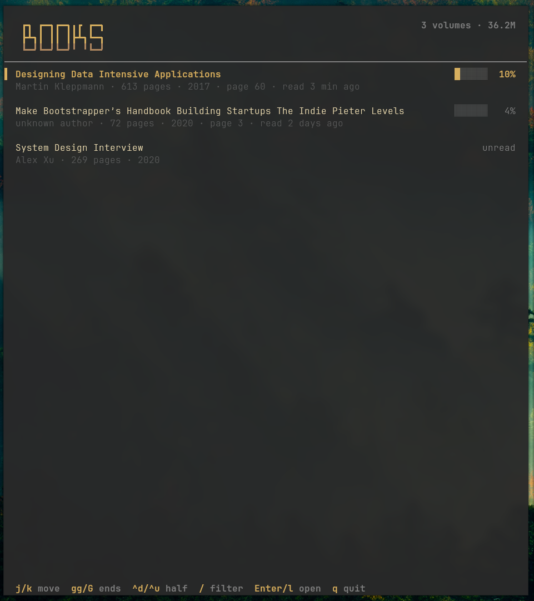

# books-tui

Browse and open your PDF library from the terminal.



- Fuzzy search across your library
- Reading progress from zathura history
- Author, page count, and year via `pdfinfo` (cached)
- Live refresh when PDFs are added or removed
- Linux and macOS

## Install

Requires Rust 1.88+.

```sh
git clone https://github.com/Prakhil-tp/books-tui.git
cd books-tui
cargo install --path .
```

Optional: `zathura` as the reader (offered for install on first run) and
`poppler-utils` for `pdfinfo` metadata.

## Usage

```sh
books-tui                      # open the library
books-tui --books-dir ~/papers # use another directory for this session
books-tui --list               # print PDF paths and exit
```

| Key | Action |
| --- | --- |
| `j` / `k` | move |
| `gg` / `G` | top / bottom |
| `Ctrl-d` / `Ctrl-u` | half page down / up |
| `/` | filter (`Enter` apply, `Esc` cancel) |
| `Enter` / `l` | open |
| `q` | quit |

## Config

Created on first run at `$XDG_CONFIG_HOME/books-tui/config.toml`
(falling back to `~/.config` on Linux, `~/Library/Application Support` on macOS):

```toml
books_dir = "~/books"
reader = "zathura"
```

`reader` may include arguments, e.g. `"zathura --fork"`. Set `NO_COLOR` to
disable colors.
